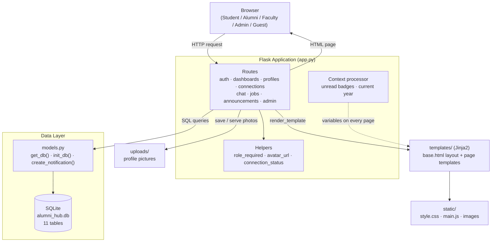
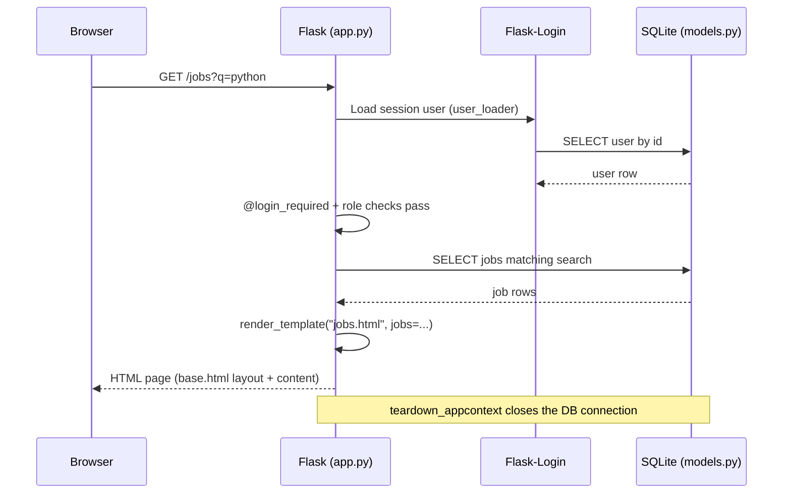

# System Architecture — Alumni Hub

## Architecture Style

Alumni Hub follows a classic **layered monolith** architecture: one Flask
application renders HTML pages on the server (no separate frontend app, no
REST API). The layers are:

| Layer | Where | Responsibility |
|-------|-------|----------------|
| **Presentation** | `templates/` (Jinja2) + `static/` (CSS/JS) | Pages, layout, styling, small browser-side behaviours |
| **Application / Routes** | `app.py` | All URL routes, request handling, validation, role checks, flash messages |
| **Data helpers** | `models.py` | Database connection, table creation (`init_db()`), shared helpers (profiles, notifications, unread counts) |
| **Database** | SQLite file `alumni_hub.db` | All persistent data — 11 tables (see [DATABASE.md](DATABASE.md)) |
| **Configuration** | `config.py` | Secret key, database path, upload folder, upload rules |

## Architecture Diagram



## Request Lifecycle



Step by step:

1. The browser sends a request; Flask matches it to a route in `app.py`.
2. Flask-Login reloads the logged-in user from the session cookie
   (`load_user` in `app.py`); blocked users (`is_active = 0`) are rejected.
3. Decorators run first: `@login_required` for member pages and
   `@role_required('alumni')` etc. for role-specific pages.
4. The route opens the per-request SQLite connection through
   `models.get_db()` (stored on Flask's `g` object), runs parameterised SQL,
   and commits writes.
5. `render_template()` renders a Jinja2 template inside the common
   `base.html` layout. A context processor adds the unread notification /
   message counts (navbar badges) to every page.
6. At the end of the request, `teardown_appcontext` closes the DB connection.

## Folder Structure

```
alumni-hub-minor/
├── app.py                  -> All routes, grouped in commented sections:
│                              SETUP -> HOME -> AUTH -> DASHBOARDS -> PROFILE
│                              -> SEARCH -> CONNECTIONS -> CHAT -> JOBS
│                              -> ANNOUNCEMENTS -> NOTIFICATIONS -> ADMIN
├── models.py               -> get_db(), init_db() (all CREATE TABLEs), helpers
├── config.py               -> SECRET_KEY, DATABASE path, UPLOAD_FOLDER, limits
├── seed.py                 -> One-time demo data (users, jobs, messages...)
├── requirements.txt        -> Flask, Flask-Login, Werkzeug
├── alumni_hub.db           -> SQLite database file (created automatically)
├── uploads/                -> Uploaded profile pictures (served by a route)
├── static/
│   ├── css/style.css       -> Custom styles on top of Bootstrap 5
│   ├── js/main.js          -> Toasts, confirm dialogs, chat scroll,
│   │                          reveal animations, counters, live search
│   └── images/default-avatar.svg
├── templates/
│   ├── base.html           -> Common layout: navbar, flash toasts, footer
│   ├── home.html, about.html, services.html, contact.html   (public pages)
│   ├── auth/               -> login, register, change password
│   ├── dashboard_student.html / dashboard_alumni.html / dashboard_faculty.html
│   ├── profile.html, edit_profile.html
│   ├── search.html, connections.html
│   ├── chat.html, conversation.html
│   ├── jobs.html, job_detail.html, post_job.html
│   ├── my_jobs.html, applicants.html, applied_jobs.html
│   ├── announcements.html, notifications.html
│   ├── admin/              -> dashboard, users, jobs, messages
│   └── errors/             -> 404.html, 500.html
└── docs/                   -> This documentation
```

## Tech Stack

| Part | Technology | Why |
|------|-----------|-----|
| Language | Python 3 | Simple, readable — ideal for a minor project |
| Web framework | Flask | Lightweight; routing + templating in one place |
| Login/session | Flask-Login | Standard, safe session handling |
| Password security | Werkzeug `generate_password_hash` / `check_password_hash` | Passwords are never stored in plain text |
| Database | SQLite via the built-in `sqlite3` module | Zero setup, one file, real SQL — easy to explain |
| Templates | Jinja2 (built into Flask) | Server-side rendering with a common layout |
| Frontend | Bootstrap 5 + Font Awesome (CDN) | Responsive UI without writing much CSS |
| Custom CSS/JS | `static/css/style.css`, `static/js/main.js` | Theme, animations, live search, counters |
| Charts | Chart.js (CDN) | "Users by Role" bar chart on the admin dashboard |

## Design Principles Followed

- **Thin, readable routes** — each route does one job and is grouped under a
  commented section header in `app.py`.
- **Parameterised SQL everywhere** — no string-built queries with user input,
  so the app is safe from basic SQL injection.
- **Idempotent schema** — every table uses `CREATE TABLE IF NOT EXISTS`, so
  `init_db()` can run on every startup safely.
- **One connection per request** — via Flask's `g`, closed automatically.
- **Referential integrity** — foreign keys with `ON DELETE CASCADE`, so
  deleting a user cleanly removes their profile, connections, messages, etc.
