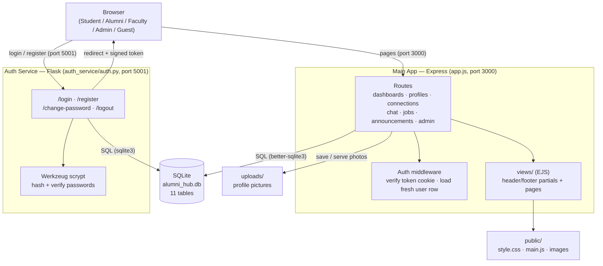
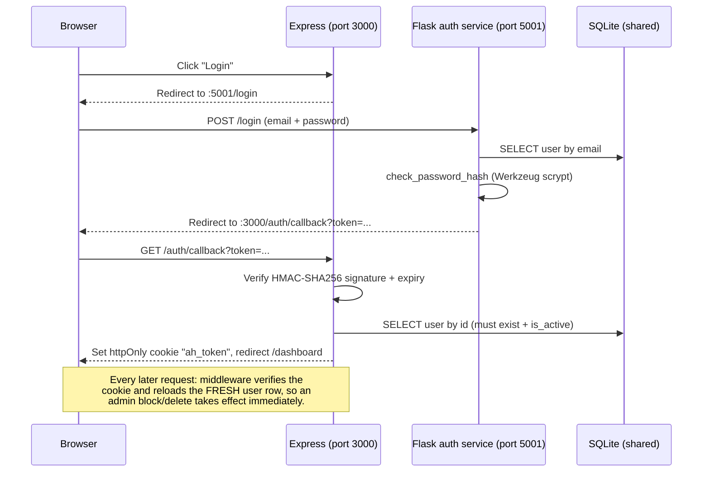

# System Architecture — Alumni Hub

## Architecture Style

Alumni Hub uses a **hybrid two-service architecture**. The project was
originally a single Python/Flask application; it was later converted so
that **most of the code is JavaScript**, with Python kept only where it
is genuinely needed — password handling.

| Service | Stack | Port | Responsibility |
|---------|-------|------|----------------|
| **Main app** | Node.js + Express + EJS | 3000 | Every page except login/register/change-password: home, dashboards, profiles, directory, connections, chat, jobs, announcements, notifications, admin panel |
| **Auth service** | Python + Flask | 5001 | ONLY `/login`, `/register`, `/change-password`, `/logout` — the only code that ever touches passwords |
| **Database** | SQLite file `alumni_hub.db` | — | One shared file, 11 tables, read/written by BOTH services (see [DATABASE.md](DATABASE.md)) |

**Why split auth into Python?** Password hashes in the database are
Werkzeug *scrypt* hashes (`generate_password_hash`). Only Werkzeug can
verify them, so credential checks must stay in Python. The Express app
therefore never sees a password: it trusts **signed tokens** issued by
the auth service (see "Login flow" below).

Inside the main app, the layering mirrors the original design:

| Layer | Where | Responsibility |
|-------|-------|----------------|
| **Presentation** | `views/` (EJS) + `public/` (CSS/JS) | Pages, layout partials, styling, small browser-side behaviours |
| **Application / Routes** | `app.js` | All URL routes, request handling, validation, role checks, flash messages |
| **Data helpers** | `models.js` | Database connection, table creation (`initDb()`), shared helpers (profiles, notifications, unread counts) |
| **Configuration** | `config.js` | Ports, database path, upload folder, `AUTH_SECRET`, auth-service URL |

## Architecture Diagram



## Login Flow (token handoff)



Step by step:

1. Guests who open a protected page (or click Login) are redirected to
   the Flask auth service.
2. Flask checks the credentials with Werkzeug and builds a token:
   `base64url(JSON {uid, email, role, exp}) + "." + base64url(HMAC-SHA256)`,
   signed with the shared `AUTH_SECRET` and valid for 6 hours.
3. The browser returns to Express at `/auth/callback`; Express verifies
   the signature (constant-time compare) and expiry, loads the user,
   stores the token in an **httpOnly cookie** and opens the dashboard.
4. The auth middleware runs on every request: verify cookie → load the
   fresh user row → attach `req.user`. Role guards
   (`requireRole("alumni")` etc.) protect role-specific pages.
5. Change-password also lives in Flask: the Express profile menu links
   to `:5001/change-password?token=...` (cookies are not shared between
   the two apps' URLs, so the token travels in the link); after success
   Flask redirects back through `/auth/callback`.
6. Logout is an Express route: it simply clears the cookie.

Flash messages are session-less: a tiny helper stores one message in a
short-lived cookie before a redirect and clears it when the next page
renders — the same one-message-at-a-time behaviour as before.

## Folder Structure

```
alumni-hub-minor/
├── package.json            -> JS dependencies (express, ejs, better-sqlite3,
│                              bcryptjs, multer, cookie-parser)
├── app.js                  -> Express server: ALL main routes, grouped in
│                              commented sections (setup, tokens, flash,
│                              public pages, auth handoff, dashboards,
│                              profiles, members/chat, jobs, admin, errors)
├── models.js               -> openDb(), initDb() (all CREATE TABLEs), helpers
├── config.js               -> PORT, DATABASE path, UPLOAD_DIR, AUTH_SECRET,
│                              AUTH_SERVICE_URL
├── seed.js                 -> Demo data (JavaScript; Werkzeug-format hashes)
├── seed.py                 -> Demo data (Python, canonical copy — kept as-is)
├── alumni_hub.db           -> SQLite database file (created by the seed)
├── uploads/                -> Uploaded profile pictures (served by a route)
├── public/
│   ├── css/style.css       -> Custom styles on top of Bootstrap 5
│   ├── js/main.js          -> Toasts, confirm dialogs, chat scroll,
│   │                          reveal animations, counters, live search
│   └── images/default-avatar.svg
├── views/
│   ├── partials/           -> header.ejs (navbar + flash) / footer.ejs —
│   │                          together they are the old base.html layout
│   ├── home.ejs, about.ejs, services.ejs, contact.ejs   (public pages)
│   ├── dashboard_student.ejs / dashboard_alumni.ejs / dashboard_faculty.ejs
│   ├── profile.ejs, edit_profile.ejs
│   ├── search.ejs, connections.ejs
│   ├── chat.ejs, conversation.ejs
│   ├── jobs.ejs, job_detail.ejs, post_job.ejs
│   ├── my_jobs.ejs, applicants.ejs, applied_jobs.ejs
│   ├── announcements.ejs, notifications.ejs
│   ├── admin/              -> dashboard, users, jobs, messages
│   └── errors/             -> 404, 500
├── auth_service/
│   ├── auth.py             -> Small Flask app: ONLY auth routes (port 5001)
│   ├── templates/          -> auth_base.html + login / register /
│   │                          change_password (same navbar/footer style)
│   ├── static/style.css    -> Copy of the main stylesheet
│   └── requirements.txt    -> Flask + Werkzeug only
└── docs/                   -> This documentation
```

## Tech Stack

| Part | Technology | Why |
|------|-----------|-----|
| Main language | JavaScript (Node.js) | The main application code |
| Web framework | Express 4 | Small, explicit routing — easy to read and explain |
| Templates | EJS | Server-side rendering with shared header/footer partials |
| Database access (JS) | `better-sqlite3` | Synchronous API — route code reads like simple sequential steps |
| Photo uploads | Multer | Standard Express upload handling |
| Auth service | Python 3 + Flask | Kept only for authentication |
| Password security | Werkzeug scrypt (`generate_password_hash` / `check_password_hash`) | Passwords are never stored or checked in plain text — and only ever in the Python service |
| Login tokens | HMAC-SHA256 signed JSON (hand-rolled, ~30 lines) | Stateless, explainable; no session store needed |
| Database | SQLite (one shared file) | Zero setup, real SQL — easy to explain |
| Frontend | Bootstrap 5 + Bootstrap Icons (CDN) | Responsive UI without writing much CSS |
| Custom CSS/JS | `public/css/style.css`, `public/js/main.js` | Theme, animations, live search, counters |
| Charts | Chart.js (CDN) | "Users by Role" bar chart on the admin dashboard |

## Design Principles Followed

- **Passwords only in Python** — the JavaScript side contains no
  password-verification code at all; it only verifies token signatures.
- **Thin, readable routes** — each route does one job and is grouped
  under a commented section header in `app.js`.
- **Parameterised SQL everywhere** — no string-built queries with user
  input, so both services are safe from basic SQL injection.
- **Idempotent schema** — every table uses `CREATE TABLE IF NOT EXISTS`;
  the identical schema lives in `models.js` and `auth_service/auth.py`,
  so either service can boot first.
- **Fresh user state** — the user row is reloaded from the database on
  every request, so admin actions apply immediately.
- **Referential integrity** — foreign keys with `ON DELETE CASCADE`, so
  deleting a user cleanly removes their profile, connections, messages, etc.
