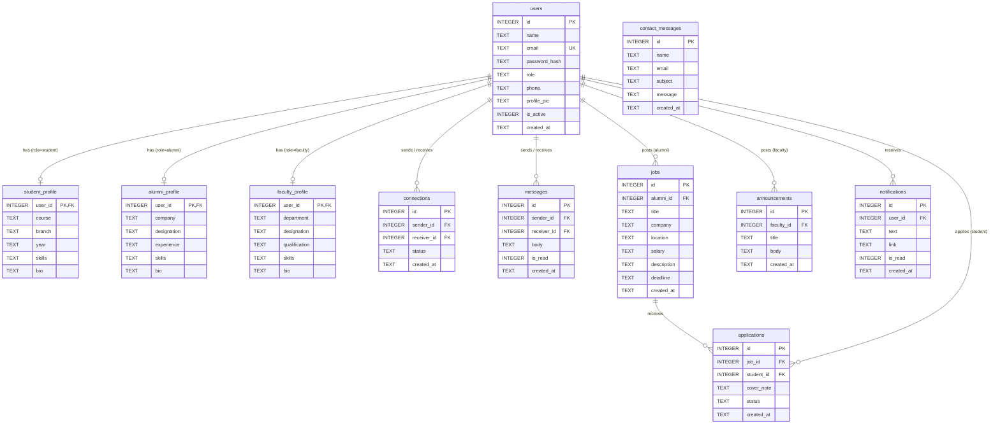

# Design — Alumni Hub

This document covers two designs: the **UI design system** (what the user
sees) and a summary of the **database design** (full details in
[DATABASE.md](DATABASE.md)).

---

## 1. UI Design System

### Colours

The theme is a professional blue family, defined once as CSS variables in
`static/css/style.css`:

| Variable / colour | Value | Used for |
|-------------------|-------|----------|
| `--ah-primary` | `#2563eb` | Primary buttons, links, navbar gradient, icons |
| `--ah-primary-dark` | `#1e40af` | Navbar/hero gradient start, button hover |
| `--ah-sky` | `#38bdf8` | Gradient end (hero, CTA band, stat cards) |
| `--ah-bg` | `#f1f5f9` | Page background |
| Card background | `#ffffff` | All content cards |
| Footer background | `#0f172a` | Dark slate footer |
| Student badge | `#2563eb` (blue) | Role badge |
| Alumni badge | `#059669` (green) | Role badge |
| Faculty badge | `#7c3aed` (purple) | Role badge |
| Admin badge | `#dc2626` (red) | Role badge |
| Stat cards | blue / green / orange / purple gradients | Dashboard statistics |

### Typography & Layout

- **Font:** "Segoe UI", system-ui fallback stack — clean and available on all
  systems (no web-font download needed).
- **Layout:** Bootstrap 5 grid inside a fixed `.container`; cards with
  `border-radius: 14px` and a soft shadow everywhere (one `.card` style).
- **Buttons:** `border-radius: 9px`, primary = `--ah-primary`, with a subtle
  hover darkening (Bootstrap variants used for success/danger/outline).

### Components

| Component | Where | Notes |
|-----------|-------|-------|
| **Navbar** | `templates/base.html` | Dark blue gradient, sticky top. Everyone sees Home / About / Services / Contact; logged-in roles also see their own links; the current page's link is highlighted (`.active` + underline animation). Right side: notification bell with unread badge, profile dropdown (guests see Login / Register). |
| **Footer** | `templates/base.html` | Same on **every** page: 4 columns — brand + about + social icons, Quick Links, Features, Contact info — plus a bottom bar with the copyright line and "Built with Flask, SQLite & Bootstrap". |
| **Flash toasts** | `base.html` + `main.js` | Every success/error message appears as a Bootstrap toast (top-right, auto-hide in 4 s). |
| **Stat cards** | Dashboards | Gradient cards with a big number and an icon tile. |
| **Member / job cards** | `search.html`, `jobs.html`, home | White cards with `.hover-lift` (rise + shadow on hover) and `.reveal` scroll-in animation; filtered live by the search box. |
| **Chat bubbles** | `conversation.html` | Blue right-aligned bubbles for my messages, white left-aligned for theirs, with timestamps. |
| **Forms** | auth, contact, post job… | Bootstrap form controls inside a centred card; required fields validated in the route. |
| **Confirm dialogs** | `main.js` | Forms with class `js-confirm` ask "Are you sure?" before deletes/blocks. |

### Animations (kept subtle and professional)

| Animation | How | Where |
|-----------|-----|-------|
| Hero gradient shift | CSS `background-position` keyframes (14 s loop) | Home hero, Services/Contact hero, CTA band |
| Scroll-in reveal | `.reveal` + IntersectionObserver adds `.visible` (fade + 24 px slide-up) | Major sections and cards on public pages, directory, jobs |
| Count-up numbers | `requestAnimationFrame` count from 0 to `data-count` when visible | Home-page statistics |
| Card hover lift | CSS transform + shadow transition | Feature/service/member/job cards |
| Nav underline | CSS `::after` scaleX transition on hover/active | Navbar links |
| Live search | JS `input` event filters `.filter-item` cards instantly | Members directory, Jobs page |

Accessibility touches: animations are disabled under
`prefers-reduced-motion`, and reveal-hidden content only applies when
JavaScript is enabled (`html.js`), so nothing is ever hidden from
no-JS visitors or screen-reader users.

### Page-by-Page Design Notes

| Page | Design notes |
|------|--------------|
| **Home** (`/`) | Animated hero with Join/Login (or Dashboard) buttons → 4 live stat cards with count-up → "What can you do here?" feature cards → Services preview (4 mini cards + link) → Latest Jobs (from DB) → CTA band |
| **About** (`/about`) | Intro card, Mission & Vision cards side by side, module list card, technology-pill strip |
| **Services** (`/services`) | Hero strip → 6 service cards with icons → "How It Works" 3-step strip (numbered circles) → CTA band |
| **Contact** (`/contact`) | Hero strip → 3 info cards (address/email/phone) → centred contact form card |
| **Login / Register** | Centred card; login page has 4 one-click demo-account buttons that auto-fill the form |
| **Dashboards** | Greeting + role badge, 4 gradient stat cards, quick-link cards, profile summary |
| **Members** (`/search`) | Search card (text + role filter) → responsive card grid with avatar, role badge, skills and a context-aware action button (Connect / Request Sent / Respond / Message) |
| **Jobs** (`/jobs`) | Search bar → card grid with company, salary, deadline, Apply/Applied state |
| **Chat** | Conversation list with last message + unread count; chat window with bubbles and auto-scroll |
| **Admin** | Stat cards + Chart.js role chart + recent users; management pages use tables with action buttons |
| **Errors** | Friendly 404 / 500 pages in the same layout |

### Responsive Behaviour

- Bootstrap breakpoints: cards go 3-per-row → 2 → 1 as the screen shrinks;
  stat cards are 2-per-row on phones with reduced padding/font sizes
  (dedicated `@media (max-width: 576px)` rules in `style.css`).
- The navbar collapses into a hamburger menu below the `lg` breakpoint.
- The footer columns stack vertically on mobile.
- The chat box is shorter (340 px) and bubbles wider (88%) on small screens.

---

## 2. Database Design (summary)

The database is a single SQLite file with **11 tables**. One `users` table
holds every account; each non-admin role has its own profile table
(one-to-one with `users`). All relationships use foreign keys with
`ON DELETE CASCADE`.

`contact_messages` has no foreign key — it stores messages from **public
visitors** of the Contact page, who may not have an account. Full column
details and sample queries: [DATABASE.md](DATABASE.md).
